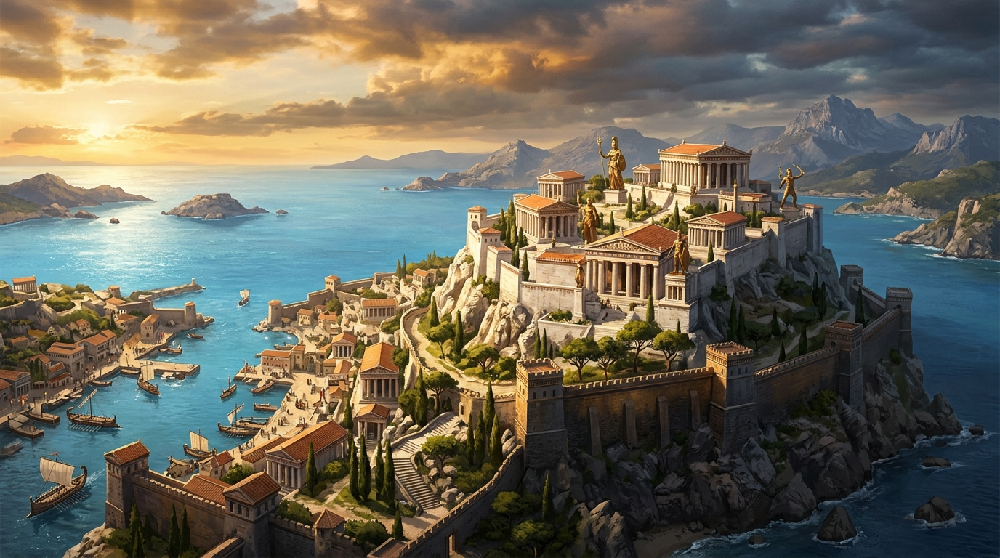
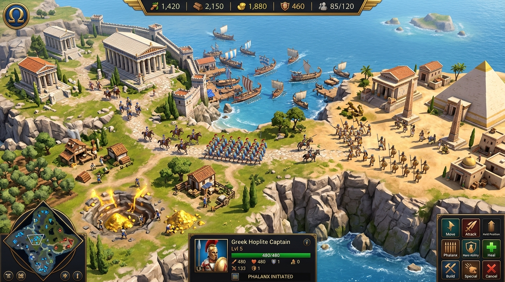
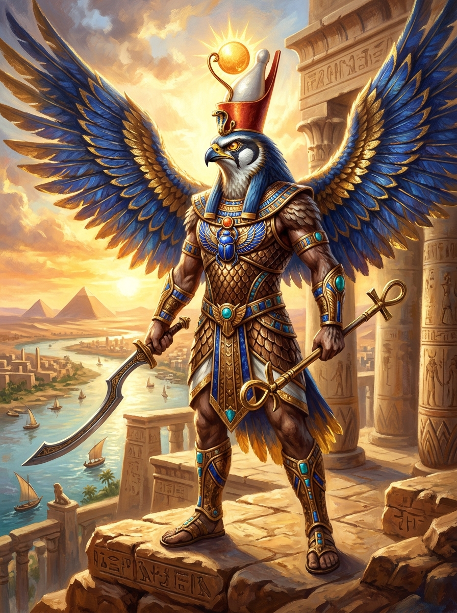
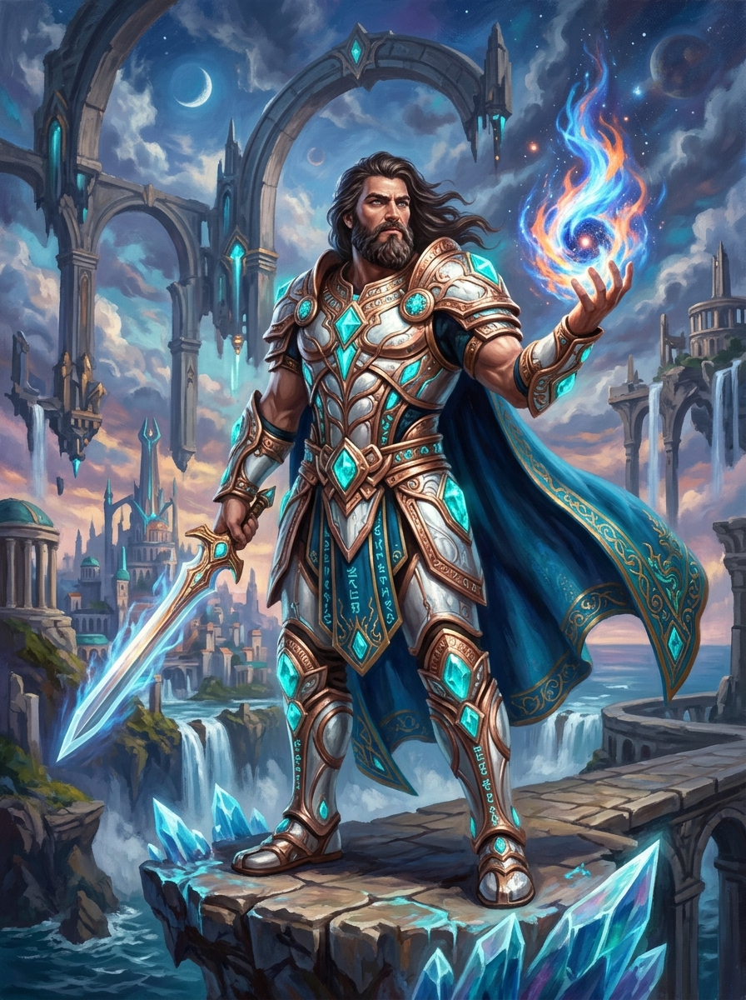
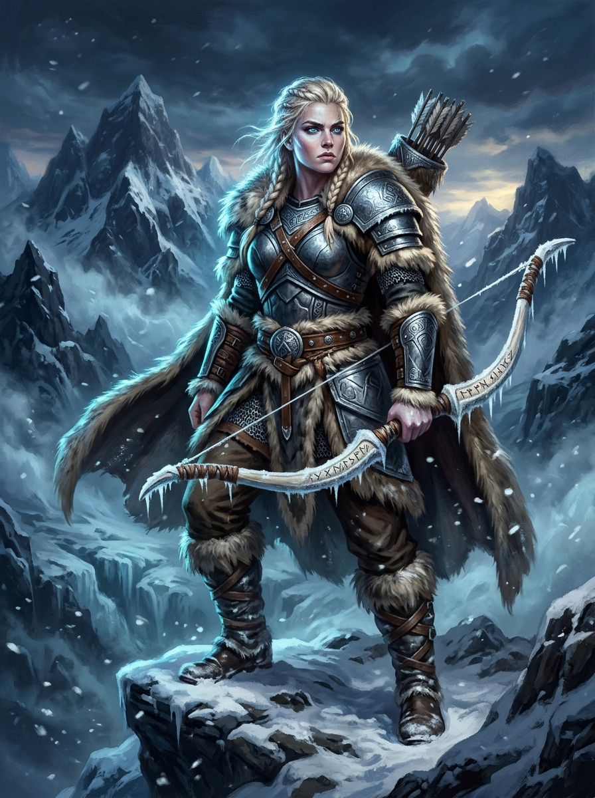
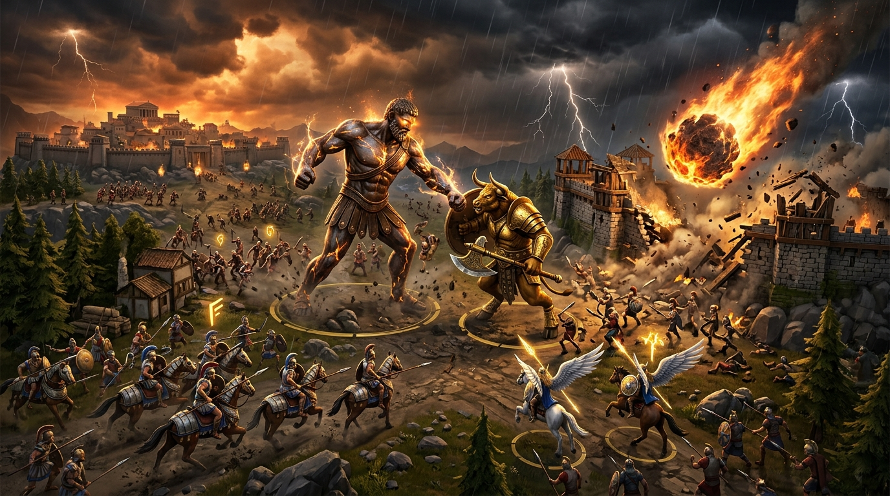
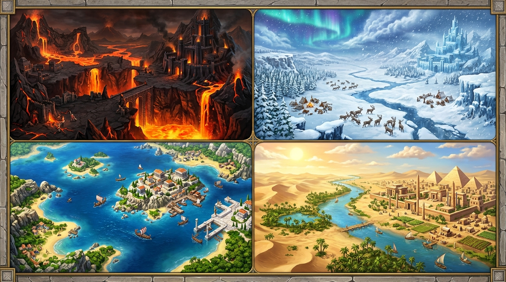
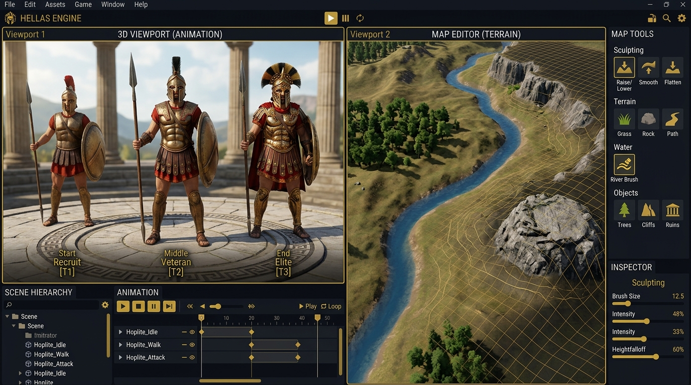
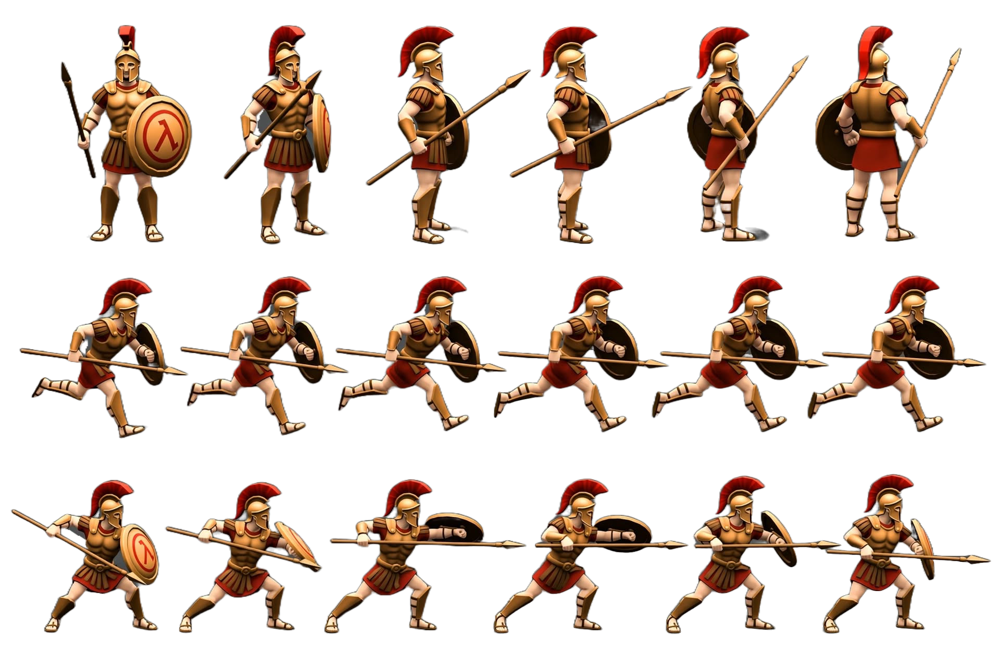

<div align="center">



# ⚡ Age of Mythology: Olympus

**Um projeto Open Source de Estratégia em Tempo Real (RTS) mitológico para Celular, Tablet e Web — mantendo viva a magia clássica dos panteões antigos.**

[](#-como-contribuir)
[](https://t.me/+ttnwf5JrlFdlZWY5)
[](#%EF%B8%8F-arquitetura-e-stack-tecnol%C3%B3gica)
[](#%EF%B8%8F-arquitetura-e-stack-tecnol%C3%B3gica)
[](#%EF%B8%8F-arquitetura-e-stack-tecnol%C3%B3gica)

</div>

---

## 🤝 Chamado para Colaboradores (UI/UX, Arte 3D & Engenharia RTS)

> **💬 Quer ajudar a elevar o nível visual e técnico deste projeto?**
> 👉 **Entre no nosso Grupo Oficial de Colaboradores no Telegram:** [**https://t.me/+ttnwf5JrlFdlZWY5**](https://t.me/+ttnwf5JrlFdlZWY5)

### A História Real do Projeto

**Age of Mythology: Olympus** nasceu da vontade de manter vivo um dos jogos que marcaram a minha infância — trazendo a experiência completa de **RTS mitológico clássico** (coleta de recursos, construção de cidadelas, avanço de eras, criaturas míticas e poderes divinos) adaptada para **celular e tablet**, além de rodar diretamente no navegador.

Quero ser 100% transparente com quem chegar ao repositório: **eu não sou programador**. Todo o código construído até este ponto foi criado **100% por agentes de inteligência artificial**, guiados pela minha visão de fã sobre cada mapa, panteão, formação e mecânica clássica.

Agora, o projeto chegou a um ponto sólido de mecânicas e sistemas, mas **precisa de mãos humanas profissionais e criativas** para dar o próximo salto de qualidade — especialmente na **Interface Gráfica (UI/UX)**, para tornar o jogo visualmente impecável, intuitivo no toque (mobile/tablet) e fluido como um título de estúdio.

### 🔍 Onde mais precisamos de ajuda profissional

| Área Prioritária | O que buscamos aprimorar |
| :--- | :--- |
| 🎨 **UI/UX & Interface Gráfica (Prioridade Máxima)** | Redesign e refino visual dos menus, HUD tática mobile/tablet, tipografia, ícones, molduras, minimapa, painéis de comando e responsividade touch. |
| 🗿 **Arte 3D, Shaders & Materiais** | Otimização de malhas Three.js, shaders de água/lava/neve, iluminação, animações de unidades e leitura visual clara em telas pequenas. |
| 📱 **Mobile-First & Controles Touch** | Gestos de seleção em caixa, pinça/zoom, joystick virtual, ergonomia de botões para polegar e performance WebGL em smartphones. |
| ⚙️ **Engenharia RTS & Multiplayer** | Otimização do loop de simulação, sincronização WebSocket (`server.ts`), pathfinding e balanceamento entre civilizações. |
| 🖌️ **Arte 2D, Retratos & Áudio** | Ilustrações de deuses menores, miniaturas de unidades/tecnologias, efeitos sonoros e bancos de vozes culturais. |

Se você é designer de UI/UX, artista 3D, desenvolvedor frontend/Three.js, especialista em áudio ou simplesmente apaixonado por RTS e quer construir algo incrível em comunidade, **entre no grupo do Telegram**: **[https://t.me/+ttnwf5JrlFdlZWY5](https://t.me/+ttnwf5JrlFdlZWY5)**.

---

## 🎮 Visão Geral e Dinâmica de Jogo

**Age of Mythology: Olympus** recria a experiência completa de um RTS mitológico clássico em uma engine própria em **TypeScript + Three.js + WebSocket**, permitindo alternar dinamicamente entre câmera **2.5D isométrica clássica** e **3D em perspectiva livre**, além de oferecer modo **Day/Night** (Ciclo Dia e Noite) e **4 perfis de escala**.

<div align="center">
  
  <br />
  <sub><i>Dinâmica em tempo real: coleta de recursos (Alimento, Madeira, Ouro e Favor), barra de Eras, minimapa tático em losango, retrato da unidade selecionada e grade de comandos pensada para toque e desktop.</i></sub>
</div>

### 🔄 Loop Principal da Partida

1. **Economia & Gestão Inteligente de Aldeões**:
   - Quatro recursos fundamentais: **Alimento** (caça silvestre, fazendas, pesqueiros, frutas), **Madeira** (bosques específicos de cada bioma), **Ouro** (minas de ouro e rotas comerciais de caravanas/barcos) e **Favor Divino** (obtido conforme a identidade de cada panteão — oração em templos, combate, monumentos ou controle de relíquias).
   - Sistema de **Prioridade Automática de Aldeões**, **Sino da Cidade** (evacuação rápida para dentro de Centros Urbanos, Torres e Fortalezas) e **Mercado Divino** para troca dinâmica de recursos e tributos entre aliados.
2. **Construção de Bases & Controle Territorial**:
   - Expansão por **Assentamentos** neutros para erguer novos **Centros Urbanos** e aumentar o limite populacional.
   - Muralhas conectáveis com **Portões**, **Torres de Vigia**, **Fortalezas / Palácios**, **Quartéis**, **Estábulo / Campo de Tiro**, **Armaria**, **Docas Navais**, **Mercado**, **Templo** e **Maravilha**.
3. **5 Eras Evolutivas & Deuses Menores**:
   - Avance da **Era Arcaica (I)** → **Era Clássica (II)** → **Era Heroica (III)** → **Era Mítica (IV)** → **Era V: Era dos Deuses**, escolhendo entre **Deuses Menores** a cada transição para desbloquear novos **Poderes Divinos**, **Unidades Míticas** e **Tecnologias Exclusivas**.

<div align="center">
  <table>
    <tr>
      <td align="center" width="33%">
        
        <br /><sub><b>Hórus</b> · Panteão Egípcio</sub>
      </td>
      <td align="center" width="33%">
        
        <br /><sub><b>Prometeu</b> · Panteão Atlante</sub>
      </td>
      <td align="center" width="33%">
        
        <br /><sub><b>Skadi</b> · Panteão Nórdico</sub>
      </td>
    </tr>
  </table>
  <sub><i>Seleção de Deuses Menores ao avançar de Era, inspirando a progressão estratégica de cada panteão.</i></sub>
</div>

4. **Combate Tático, Formações & Poderes Divinos**:
   - Sistema clássico de contra-ataque em triângulo (**Infantaria ↔ Cavalaria ↔ Arqueiros**), **Unidades de Cerco**, **Frotas Navais** (com embarque/desembarque em **Navios de Transporte**), **Heróis** (que multiplicam dano contra criaturas míticas e carregam **Relíquias** para o Templo) e **Titãs** na Era V.
   - **5 Formações Táticas** aplicáveis em tempo real: **Bloco**, **Linha**, **Escalonada**, **Falange** (`+25%` armadura, `-15%` velocidade) e **Cunha / Wedge** (`+20%` velocidade, `+15%` dano de carga), além de posturas de combate (Agressiva, Defensiva, Manter Posição).
   - **30 Poderes Divinos** inspirados no sistema moderno estilo *Retold*: relançáveis mediante custo crescente em **Favor Divino**, com redução de custo na **Era das Maravilhas**.

<div align="center">
  
  <br />
  <sub><i>Combates em escala épica na Era Mítica: Colosso, Minotauro, Valquírias e poderes devastadores como Chuva de Meteoros e Tempestade de Raios.</i></sub>
</div>

---

## 🏛️ Panteões & Deuses Maiores

O projeto conta com **5 panteões jogáveis completos** (15 Deuses Maiores + seus respectivos Deuses Menores, tecnologias e unidades míticas) e **8 novos panteões planejados** já estruturados no catálogo para expansão da comunidade:

### Panteões Jogáveis

| Panteão | Deuses Maiores | Arquitetura & Identidade | Bônus & Favor Principal |
| :--- | :--- | :--- | :--- |
| 🏛️ **Gregos** | **Zeus**, **Poseidon**, **Hades** | Mármore dórico e telhados de terracota | Início com `+100 Ouro`, Hoplitas em Falange, heróis nomeados e Relâmpago fortalecido |
| 🏺 **Egípcios** | **Rá**, **Ísis**, **Set** | Pilones de arenito, obeliscos e discos solares | Início com `+120 Alimento`, Monumentos geradores de Favor, Faraó construtor e Chuva de Rá |
| 🪓 **Nórdicos** | **Odin**, **Thor**, **Loki** | Salões de madeira escura, telhados íngremes e runas | Início com `+120 Madeira`, infantaria construtora, Favor gerado em combate e Ragnarok Flamejante |
| 🔱 **Atlantes** | **Cronos**, **Oranos**, **Gaia** | Cúpulas turquesa, pedra marfim e oricalco | Início com `+25 Favor`, Cidadãos autônomos e promoção individual de unidades para **Heróis** |
| 🐉 **Chineses** | **Fu Xi**, **Nu Wa**, **Shennong** | Pagodes imperiais de jade, pilares vermelhos e telhados curvos | Início com `+80 Madeira` / `+80 Ouro`, Kuafu construtor, Dragão Azul e Feixe Solar |

### Panteões em Desenvolvimento (Roadmap Comunitário)

- ⛩️ **Japoneses** (*Amaterasu*) · 🌞 **Astecas** (*Huitzilopochtli*) · 🦅 **Romanos** (*Júpiter*) · 🐙 **Eldritch** (*Azathoth*)
- 🍀 **Celtas** (*Lugh*) · 🏺 **Babilônios** (*Marduk*) · 🪶 **Lakota** (*Anpetu Wi*) · ❄️ **Jotunn** (*Surtr*)

---

## 🗺️ 31 Mapas Aleatórios, Biomas, Clima & Fauna

O motor cartográfico implementa os **27 mapas oficiais de *Age of Mythology: The Titans*** (21 mapas clássicos + 6 da expansão) além de **4 mapas bônus** (`Yucatán`, `Rio Amarelo`, `Total War` e `RMS Personalizado`). Cada mapa possui altura de terreno procedural, rios/mares navegáveis, flora distinta, fauna caçável e efeitos climáticos e de shader dedicados (como **rios de lava incandescentes em Érebo** e **águas congeladas/nevascas na Tundra**).

<div align="center">
  
  <br />
  <sub><i>Quatro dos 6 biomas disponíveis: Érebo (lava e pontes), Tundra (aurora e neve), Arquipélago/Mediterrâneo (disputa naval) e Rio Nilo/Oásis (deserto e travessias rasas).</i></sub>
</div>

<details>
<summary><b>📜 Ver lista completa dos 31 Mapas Aleatórios e regras especiais</b></summary>

#### Os 6 Mapas de *The Titans*
- **Terras Altas (Highland)**: Grande rio central dividindo platôs com pontes de pedra.
- **Ilhas (Islands)**: Cada jogador inicia em sua própria ilha, exigindo Docas, Barcos de Pesca e Transportes.
- **Terra Desconhecida (Land Unknown)**: Terreno e recursos sorteados a cada partida sem grandes mares.
- **Pântano (Marsh)**: Terreno alagado com poças rasas navegáveis, florestas densas e passagens estreitas.
- **Megalópole (Megalopolis)**: Base inicial avançada com múltiplos Centros Urbanos, muralhas e torres já erguidas.
- **Tundra**: Ambiente glacial aberto com tempestades de neve, madeira escassa e manadas de renas e bois-almiscarados.

#### Os 21 Mapas Originais do Jogo Base
- **Acrópole** · **Alfheim** · **Anatólia** · **Arquipélago** · **Érebo** (rios de lava e javalis) · **Lago Fantasma** (lago congelado central não edificável) · **Jotunheim** (gargalo montanhoso único) · **Rei da Colina** (*Plenty Vault* central com vitória por controle) · **Mediterrâneo** (mar circular central) · **Midgard** (continente cercado por oceano) · **Nômade** (início apenas com aldeões e trégua inicial) · **Oásis** (madeira concentrada no centro) · **Rio Nilo** (travessias rasas e pesca) · **Savana** (planície aberta com grandes manadas) · **Mar de Vermes** (fortaleza inicial cercada por mares) · **Morte Súbita** (eliminação caso a Cidadela caia sem reconstrução) · **Migração em Equipe** (migração naval obrigatória das ilhas ao continente) · **O Desconhecido** (sorteio total incluindo mares ou desertos) · **Vale dos Reis** (minas ricas centrais guardadas por criaturas neutras) · **Vinlandsaga** (ilha inicial para colonização de continente) · **Poço d'Água** (lagos rasos rodeados de fauna).

#### 4 Mapas Bônus + Tamanhos
- **Yucatán** · **Rio Amarelo** · **Total War** · **RMS Custom**
- **Tamanhos de Mundo**: **Normal** (`148×148`), **Grande** (`204×204`) e **Gigante** (`264×264`).
- **Modos de Vitória**: Supremacia, Conquista, Relâmpago, Combate Mortal e Regicídio, além de **Tempo de Tratado** configurável.

</details>

---

## ✨ Campanhas, Multiplayer & Ferramentas Integradas

### 📖 Campanhas & IA
- **2 Livros de Campanha (45 cenários)**:
  - **A Queda do Tridente** (32 cenários atravessando Atlântida, Grécia, Egito e Terras Nórdicas).
  - **A Nova Atlântida** (13 cenários da expansão).
- **IA Estratégica** com níveis de dificuldade ajustáveis, gerenciamento econômico, construção progressiva, defesa de base e uso de Poderes Divinos.

### 🌐 Multiplayer Online em Tempo Real (WebSocket)
- **Lobby e Matchmaking** integrado no servidor Express + `ws` (`/ws`), suportando **salas de até 6v6 (12 jogadores/bots)**, códigos de sala, escolha de brasão, cor, panteão e time.
- **Chat global no lobby e chat tático em partida** (todos/aliados).
- **Console de Cheats Clássicos** para partidas personalizadas e testes (`RED TIDE`, `IN DARKEST NIGHT`, `CLEAR SKIES`, `WRATH OF THE GODS`, entre outros).

### 🛠️ Galeria 3D, Laboratório RMS (`.xs`) & Editor de Cenários

<div align="center">
  
  <br />
  <sub><i>Ferramentas internas de criação: Inspetor 3D com progressão de armaduras (Tiers T1–T4) e Editor de Cenários / Terreno com pincéis de elevação, rios e relíquias.</i></sub>
</div>

- **Galeria 3D (`3D Studio`)**: Inspetor interativo em Three.js para visualizar modelos de unidades, construções, deuses, fauna, tiers de armadura do Hoplita (`T1` a `T4`) e todos os biomas.
- **Renderização Híbrida Mobile-Ready**: Suporte a alternância de renderização do Hoplita entre **3D completo**, **Sprite Isométrico (`hoplita-iso.png`)**, **BRG** e **UV 2D** — permitindo otimizar FPS em celulares mais modestos.
- **Laboratório de Mapas RMS (`.xs`)**: Interpretador de Random Map Scripts para gerar e testar mapas procedurais ao vivo.
- **Editor de Cenários Completo**: Escultura de terreno, pintura de texturas, colocação de unidades/estruturas/relíquias, gatilhos (*triggers*) e importador de cenários.
- **Pós-Jogo & Replay**: Linha do tempo da partida, gráficos comparativos econômicos/militares e painel de estatísticas.

<div align="center">
  
  <br />
  <sub><i>Sprite sheet isométrico multi-estado usado no modo de renderização leve 2D/BRG para dispositivos móveis.</i></sub>
</div>

### 🔊 Áudio Dinâmico & Bancos de Vozes Culturais
- **Trilha Sonora Adaptativa**: Alterna suavemente entre mixes *standard* e *mellow* de acordo com a proporção populacional e o momento da partida, incluindo faixas temáticas por civilização.
- **Bancos de Voz (`SoundManager`)**: Fala cultural contextual ao selecionar e dar ordens às unidades (ex.: saudações e comandos gregos clássicos como *Próstagma?* e atlantes como *Yuji?*).

---

## 🏗️ Arquitetura e Stack Tecnológica

| Camada | Tecnologias |
| :--- | :--- |
| **Frontend & UI** | React 19, TypeScript (`strict: true`), Vite 8, Tailwind CSS v4, Lucide React |
| **Motor Gráfico 3D / 2.5D** | Three.js (`^0.187.0`), câmera ortográfica/perspectiva, ciclo dia/noite, shaders de terreno/água/lava/clima |
| **Backend & Multiplayer** | Node.js, Express 4, WebSocket (`ws`), sincronização autoritativa de salas e comandos (`/ws`) |
| **Áudio & Ferramentas** | Web Audio API (`SoundManager` + música adaptativa), Voice Studio Server, Interpretador `.xs` |

```text
src/
├── App.tsx                     # Orquestração principal entre Menu, Jogo, Editor, Galeria 3D e RMS Lab
├── civilizacao/                # Definições e dados culturais por civilização
├── components/
│   ├── hud/                    # HUD modular (barra superior, recursos, comandos, seleção, diálogos e modais)
│   ├── gallery3d/              # Inspetor 3D de modelos, animações, armaduras e terrenos
│   ├── GameHUD.tsx             # Orquestrador da interface durante a partida
│   ├── Minimap.tsx             # Minimapa tático em tempo real
│   ├── MultiplayerOnlineHub.tsx# Lobby e salas WebSocket (até 6v6)
│   ├── ScenarioEditor.tsx      # Editor completo de mapas e gatilhos
│   ├── RmsMapLab.tsx           # Laboratório de Random Map Scripts (.xs)
│   └── TitleScreen.tsx         # Menu inicial clássico e navegação
├── game/
│   ├── audio/                  # SoundManager com bancos de vozes culturais (Grego, Atlante, etc.)
│   ├── data/                   # Panteões, Eras, Formações, Escalas e Roster de unidades
│   ├── engine/                 # Subsistema modular da engine (renderização, áudio, IA, combate)
│   ├── models/                 # Construtores procedurais 3D (unidades, edifícios, fauna)
│   ├── combat.ts               # Regras de dano, bônus contra mitologia, formações e projéteis
│   ├── engine.ts               # Loop principal da simulação RTS
│   ├── navigation.ts           # Movimentação, pathfinding e colisão
│   └── scenarioTriggerRuntime.ts# Execução de gatilhos e missões de campanha
├── god powers/                 # 30 Poderes Divinos modulares (Meteoro, Chuva, Terremoto, Buraco Negro, etc.)
├── maps/                       # Catálogo e geração dos 31 mapas aleatórios e regras especiais
├── rendering/                  # Efeitos visuais, partículas e pós-processamento
├── server/                     # Rotas auxiliares do servidor (Voice Studio)
└── textura/                    # Texturas procedurais e variações sazonais por bioma
```

---

## 🚀 Como Rodar Localmente

### Pré-requisitos
- **Node.js 20+** e **npm**

### Instalação e Execução

```bash
# 1. Clone o repositório
git clone <URL_DO_REPOSITORIO>
cd age-of-mythology-olympus

# 2. Instale as dependências
npm install

# 3. (Opcional) Caso deseje ativar recursos de servidor que usam a API Gemini,
# crie um arquivo .env na raiz com:
# GEMINI_API_KEY=sua_chave_aqui

# 4. Inicie o servidor de desenvolvimento (Frontend Vite + Backend Express/WebSocket na porta 3000)
npm run dev
```

Após iniciar, acesse `http://localhost:3000` no navegador do computador, tablet ou celular na mesma rede.

### Scripts Disponíveis

| Comando | Descrição |
| :--- | :--- |
| `npm run dev` | Inicia o servidor full-stack (`server.ts` com Vite e WebSocket `/ws`) na porta `3000` |
| `npm run build` | Gera o bundle de produção otimizado em `dist/` via Vite |
| `npm run start` | Executa o servidor Express + WebSocket em modo produção |
| `npm run lint` | Executa checagem estrita de tipos (`tsc --noEmit`) |

---

## 🌟 Como Contribuir

Todo Pull Request, sugestão de interface, protótipo no Figma, shader 3D, ícone ou correção de bug é extremamente bem-vindo!

1. **Entre no grupo de colaboradores no Telegram** para conversar diretamente sobre prioridades de UI/UX, arte e código:
   👉 **[https://t.me/+ttnwf5JrlFdlZWY5](https://t.me/+ttnwf5JrlFdlZWY5)**
2. Faça um **Fork** do projeto e crie uma branch para sua contribuição:
   ```bash
   git checkout -b feat/melhoria-hud-mobile
   ```
3. Valide tipos e build antes de abrir o Pull Request:
   ```bash
   npm run lint
   npm run build
   ```
4. Abra seu **Pull Request** descrevendo claramente a mudança (e com capturas de tela caso envolva interface gráfica ou 3D!).

---

<div align="center">

Feito com nostalgia, paixão por mitologia e colaboração aberta.
**Junte-se à construção deste RTS no Telegram:** [https://t.me/+ttnwf5JrlFdlZWY5](https://t.me/+ttnwf5JrlFdlZWY5)

</div>
